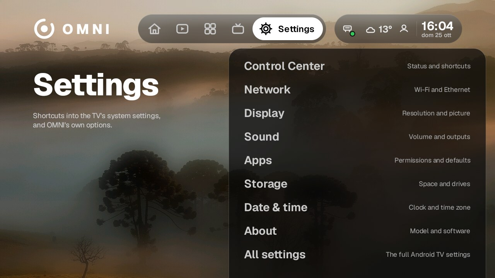
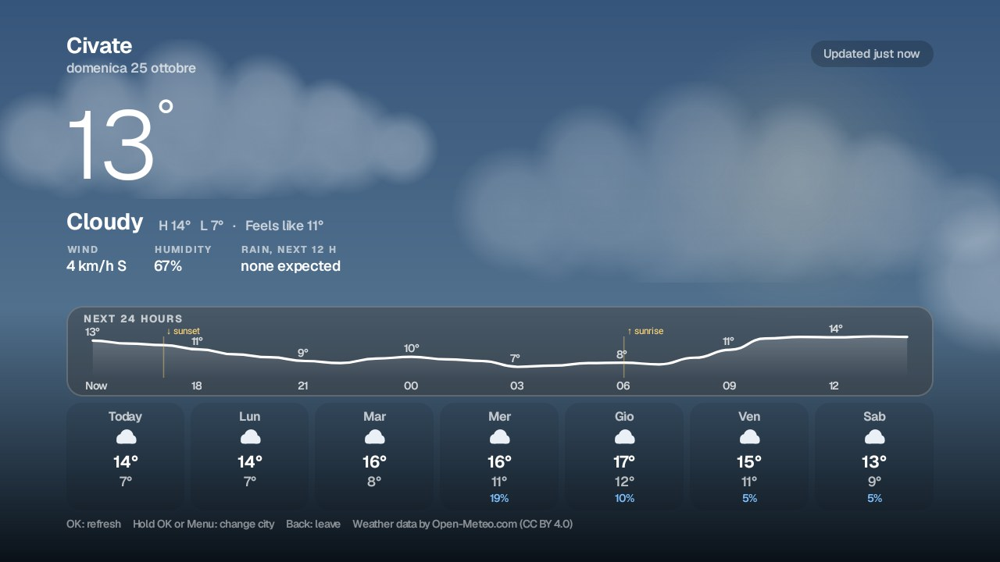
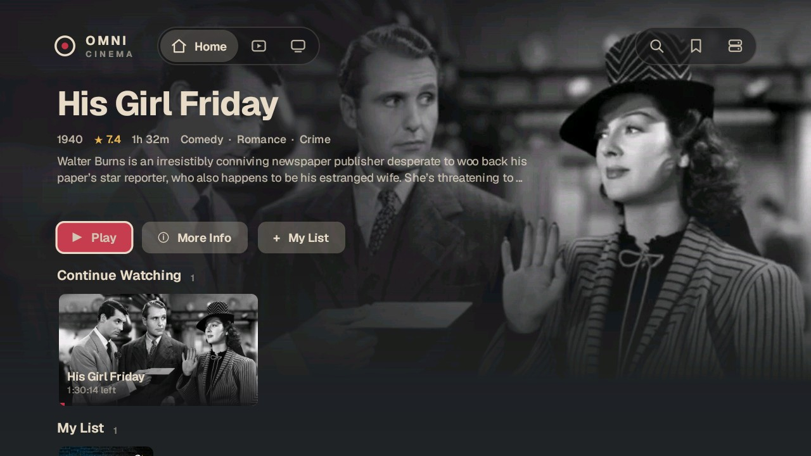
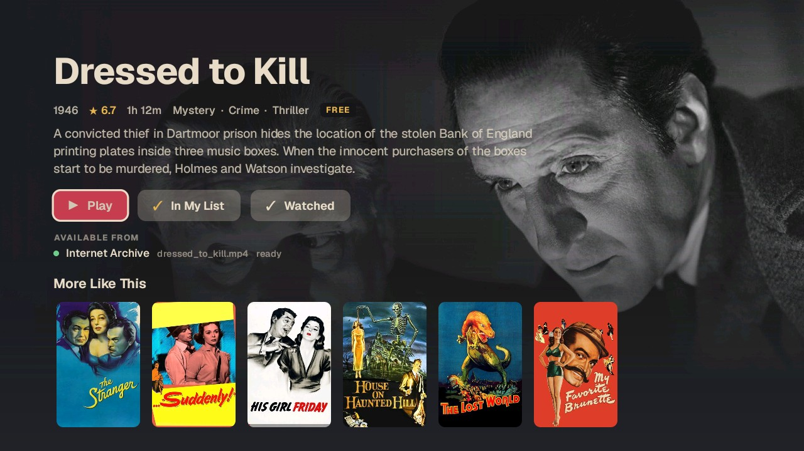

# OMNI TV

**A fast, ad-free, black-and-white operating-system layer for cheap Android TVs.**
Launcher, Control Center, universal search, native apps and a tiny home server for your own films. Free, open source, no accounts, no ads, no paid tier.

Built and measured on one deliberately weak TV (Vestel/MediaTek, Android 11, 32-bit, about 900 MB RAM, 720p) so that it stays smooth on hardware most launchers give up on.

| Settings | Weather |
|---|---|
|  |  |
| **Cinema**, playing from your own server | **Title page** (public-domain film) |
|  |  |

## What you get
- **Launcher**: Home, Watch, Apps, Live TV, Settings. Spring motion, one flat glass look, custom-drawn views instead of heavy layouts.
- **Control Center** on the right side, opened with the remote's **INFO** key: volume, HDMI inputs, server status, weather, network, shortcuts. Everything is done in place.
- **Universal search** across apps, channels, films, inputs and settings.
- **HDMI inputs** with a live preview card that expands to full screen with sound, without leaving the launcher. *Brand-dependent*, see Status.
- **Cinema**: a native player app for your own films. It reads a library from your home server, resumes where you stopped, and shares that position across devices.
- **Weather, Server status, Guide, Play, Gallery (screensaver), Control, Reference**: small native apps in the same design language.
- **`omniptvd`**: a home server in plain Python (standard library only) that scans a folder of films, matches posters and overviews through TMDB, streams the original files with byte ranges, and keeps watch positions.

## Status, honestly
- Developed and tested on **one TV**. Other TVs are untested. Key codes, memory and the HDMI tuner service differ per brand. **Testers and fixes are the most useful contribution.** Open an issue with your TV model and what happened.
- The HDMI live preview relies on the TV maker's own input service; it works differently (or not at all) on other brands.
- Measured on the reference TV: launcher APK about 0.65 MB; about 110 MB PSS on the Live TV page (our own budget was 85 MB, so there is still work to do); Live TV page 0% janky frames with p95 9.6 ms; Weather p95 15 to 16 ms. See `launcher/docs/perf/`. Stock Google TV was not measured side by side, so no comparison is claimed.
- **Not built yet**: a Premium profile with real blur and heavier animation for powerful TVs, a one-click slim-down tool, a first-run wizard. See [`docs/ROADMAP.md`](docs/ROADMAP.md).

## Install
**Easiest: download APKs from [Releases](../../releases)** and install with `adb install -r file.apk` (or a file-manager/Downloader app after enabling "unknown sources"). Start with `omni-launcher.apk`.

**Build from source**: see [`INSTALL.md`](INSTALL.md). Prefer to have an AI assistant do it with you? Tell it: *"Clone this repository and follow `AGENTS.md`."*

OMNI is an *extra* launcher. It does not remove or disable your TV's own software, and every change is reversible; undo commands are in `INSTALL.md`.

## Privacy: what the code talks to
No analytics, advertising, crash reporting or tracking code is included. The only outside connections are:

| Host | Why |
|---|---|
| `api.themoviedb.org`, `image.tmdb.org` | film metadata and posters (TMDB) |
| `api.open-meteo.com` | weather |
| `www.bing.com` | the daily wallpaper |
| `commons.wikimedia.org`, `upload.wikimedia.org` | Gallery screensaver landscapes |
| `archive.org` | optional public-domain films in Cinema |
| your own server on your LAN | library, streaming, status (plain http, PIN protected, LAN only) |

You can verify this yourself: `grep -rhoE "https?://[a-z0-9.-]+" launcher/src android/apps android/core | sort | uniq -c`.

## About the TMDB key in the release APKs
The launcher's Watch tab and Cinema's own matching use TMDB. **The release APKs include the author's TMDB v3 key**, so posters work without setup. Anyone can extract a key from an APK, so it is shared, rate-limited and may be rotated; if posters stop appearing, build your own APK with your own free key (`tmdb.token`, see `INSTALL.md`). Cinema does not need a key at all when it reads a library from your own `omniptvd`, which does the matching.

## What is deliberately not included
Channel logos and any channel or stream list. This project does not host, relay, advertise or unblock streams; you add only sources you are allowed to watch. See [`THIRD-PARTY.md`](THIRD-PARTY.md).

## Repository map
| Folder | What | Build |
|---|---|---|
| `launcher/` | OMNI TvOS launcher | Java Views, no Gradle, no libraries: `./build.sh` |
| `android/` | Cinema, Weather, Server, Guide, Play, Gallery, Control, Reference and shared `core:*` modules | Kotlin + Jetpack Compose for TV, Gradle |
| `server/` | `omniptvd` home server (Python 3 stdlib, SQLite) | `server/deploy/install.sh` |
| `docs/` | Roadmap and screenshots | |

Project rules learned the hard way (performance, focus, key lag on TVs) are in `launcher/CLAUDE.md`; they apply to humans too.

## Contributing
Tests first: `launcher/test/run.sh <jdk17>` (3298 checks), `python3 -I server/server/tests/test_*.py`, `./gradlew :core:library:test` in `android/`. Please say what you actually ran on a real TV and what you could not check.

## License
Apache License 2.0, see [`LICENSE`](LICENSE). Third-party material is listed in [`THIRD-PARTY.md`](THIRD-PARTY.md). Trademarks belong to their owners.
