
<a href="https://kiqa-dev.it"><b>Software by KIQA.DEV</b></a>

# OMNI TV

**A fast, ad-free, black-and-white operating-system layer for cheap Android TVs.**
Launcher, Control Center, universal search, native apps and a tiny home server for your own films. Free, open source, no accounts, no ads, no paid tier.

Built and measured on one deliberately weak TV (Vestel/MediaTek, Android 11, 32-bit, about 900 MB RAM, 720p) so that it stays smooth on hardware most launchers give up on.

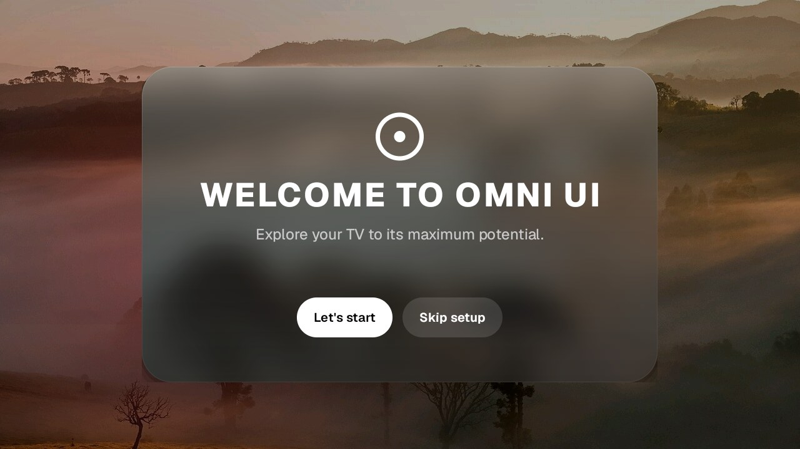

| Control Center (press INFO) | First-run setup |
|---|---|
| 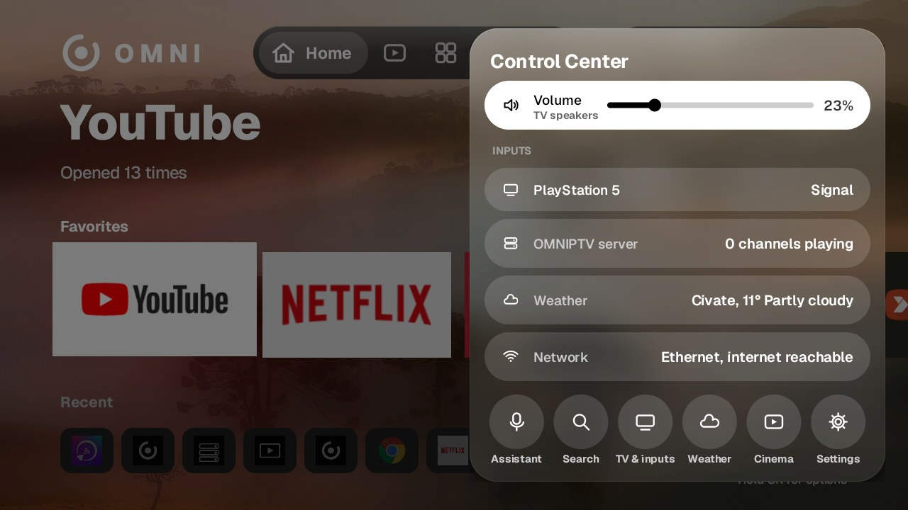 | 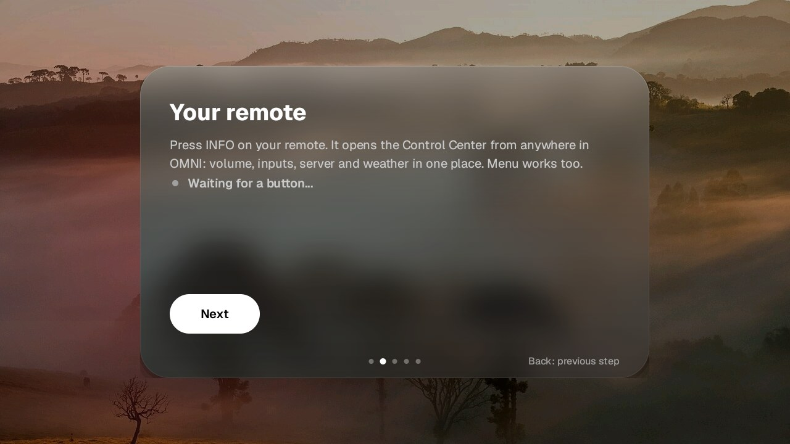 |
| **Assistant** (a pill that takes the navbar's place) | **Device notice** |
| 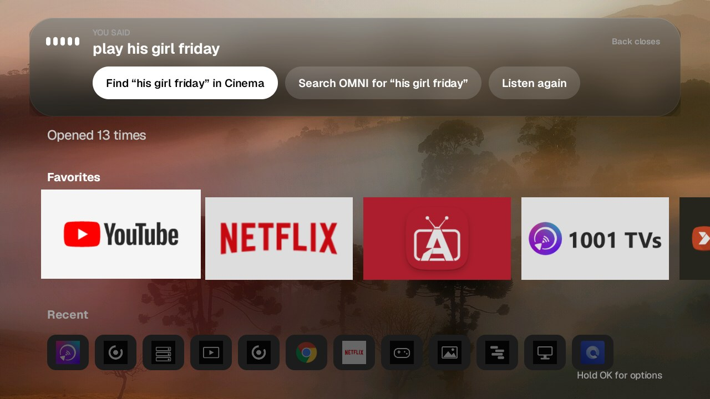 | 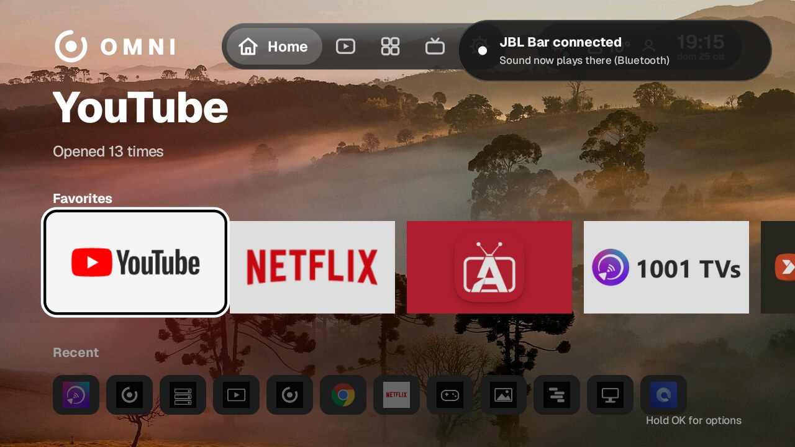 |
| **Remote buttons** | **Weather** |
| 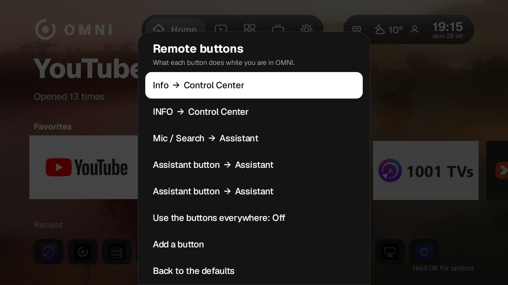 |  |
| **OMNI Cinema**: cinematic hero, your server and free public-domain films | **Browsing rows** (the hero follows what you focus) |
|  | 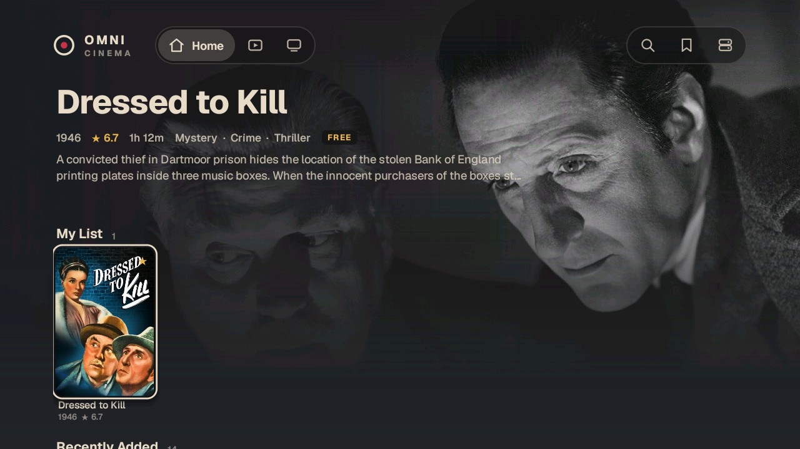 |
| **Title page** with More Like This | **Movies** with genre filters, plus Search and My List |
|  | 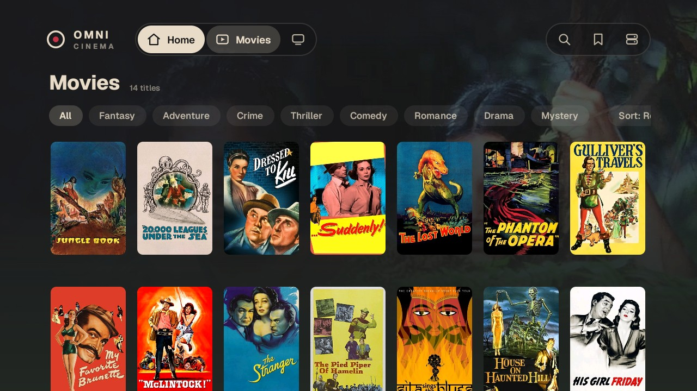 |
| **Weather: Today** | **Weather: Week** |
| 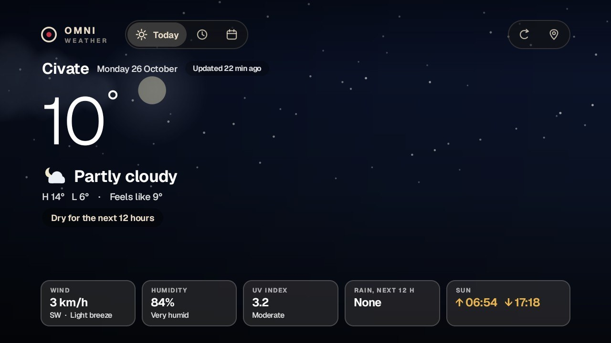 | 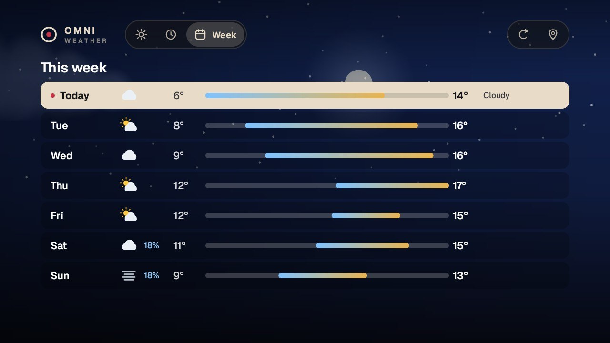 |
| **Weather: Hourly** | **Developer previews of the sky** (not real weather): sunset and rain |
| 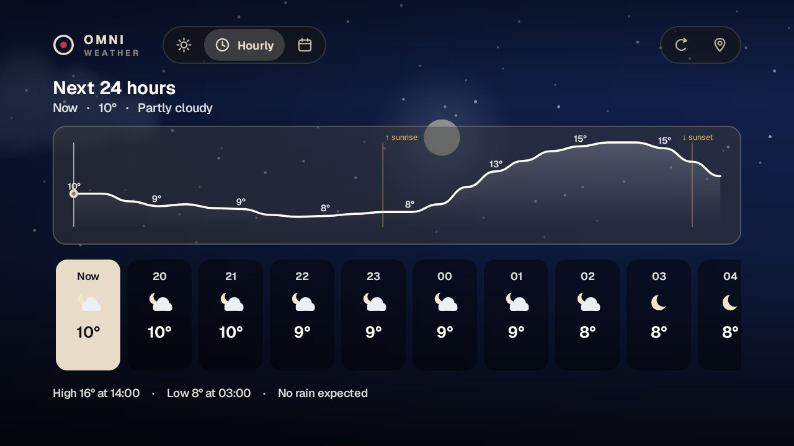 | 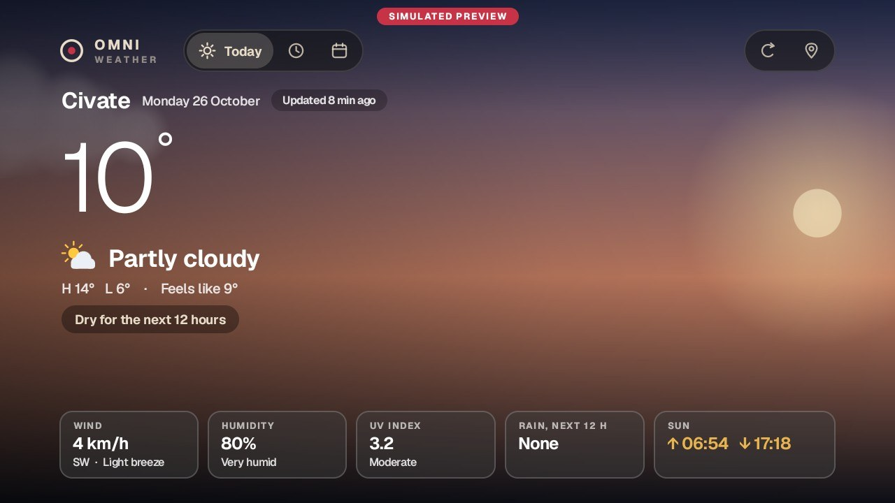 |
| **Server: Overview** | **Server: Resources** (real readings) |
| 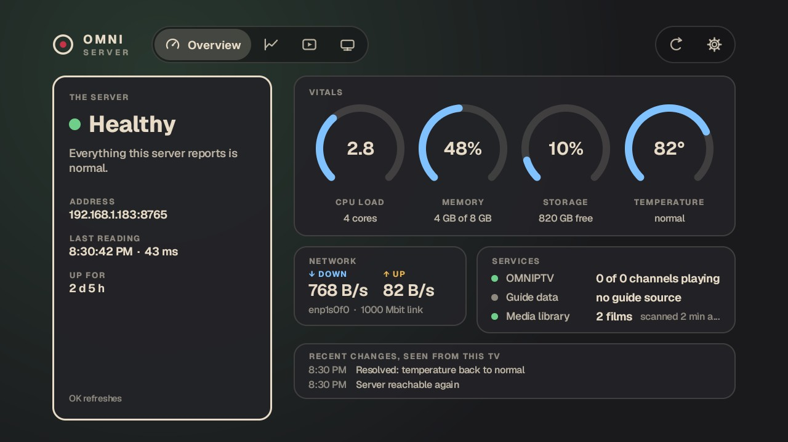 | 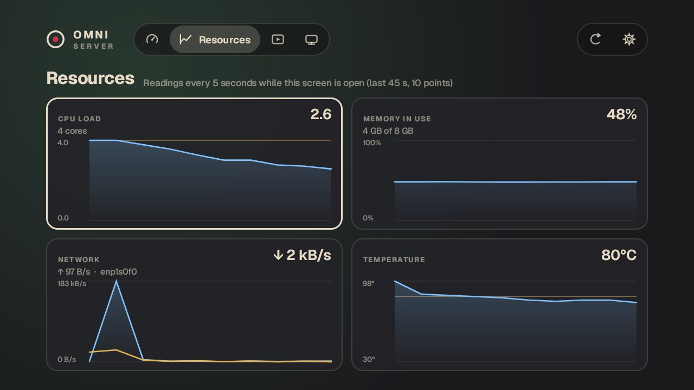 |
| **Server: Library** (with Scan now) | **Server: Devices** |
| 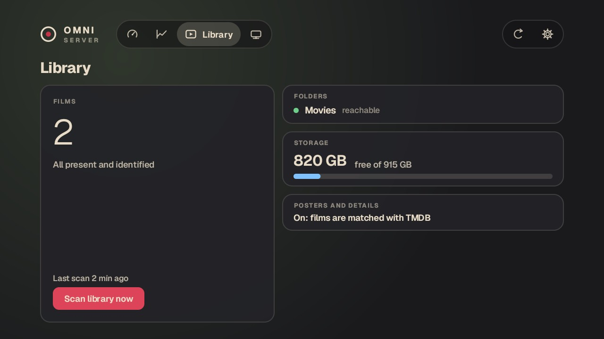 | 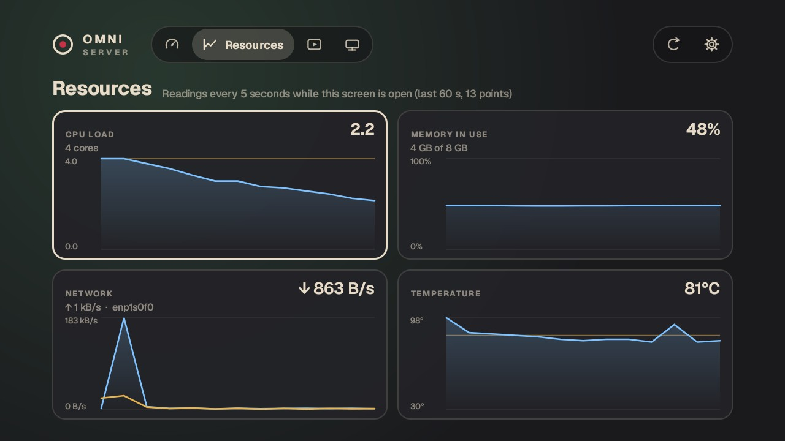 |

## What you get
- **Welcome & setup**: a liquid-glass *WELCOME TO OMNI UI* first run over your wallpaper, then Home, a live remote check, OMNI server discovery on your network, weather place and permissions. Run it again any time from Settings.
- **Assistant**: the mic/search button or the Control Center's Assistant button. Say or type TV commands in English, Italian or Albanian (*open YouTube*, *PlayStation*, *volume 30*, *weather*, *play His Girl Friday*); anything else is handed to your TV's own Google assistant / Gemini. Voice needs the TV's Google app; without it you type.
- **Device notices**: speakers and soundbars (Bluetooth, HDMI ARC/eARC, USB), game controllers, keyboards, new Chromecasts on your network, and casting to this TV, shown even over other apps.
- **Remote buttons**: choose what INFO, the colour keys and other buttons do in OMNI.
- **Launcher**: Home, Watch, Apps, Live TV, Settings. Spring motion, one flat glass look, custom-drawn views instead of heavy layouts.
- **Control Center** on the right side, opened with the remote's **INFO** key: volume, HDMI inputs, server status, weather, network, shortcuts. Everything is done in place.
- **Universal search** across apps, channels, films, inputs and settings.
- **HDMI inputs** with a live preview card that expands to full screen with sound, without leaving the launcher. *Brand-dependent*, see Status.
- **OMNI Cinema**: a streaming-style home for your own films (charcoal, ivory, crimson and gold, with the artwork setting the mood): a cinematic hero, rows for Continue Watching, My List, Recently Added, your server, free films and genres, Movies / Shows / My List / Search tabs, title pages with More Like This. It plays from your home server (resuming where you stopped, on any device), USB drives and the Internet Archive.
- **Weather** has its own atmospheric look (the sky follows the real conditions and the real sunrise and sunset; Today, Hourly and Week pages; honest about old data), see `docs/WEATHER-UX.md`.
- **Server control center** (verdict, vitals, live charts from real readings, library with a Scan action, devices that have synced; only what the server really provides, see `docs/SERVER-UX.md`) and the **Screensaver**, with Weather and Cinema, are built into the same app (each runs in its own process and exits when you close it): the weather screen, the home-server dashboard, and landscape photos when the TV is idle. No separate installs, no extra icons.
- **`omniptvd`**: a home server in plain Python (standard library only) that scans a folder of films, matches posters and overviews through TMDB, streams the original files with byte ranges, and keeps watch positions.

## Status, honestly
- Developed and tested on **one TV** (see [`docs/COMPATIBILITY.md`](docs/COMPATIBILITY.md) for what to expect elsewhere). Other TVs are untested. Key codes, memory and the HDMI tuner service differ per brand. **Testers and fixes are the most useful contribution.** Open an issue with your TV model and what happened.
- The HDMI live preview relies on the TV maker's own input service; it works differently (or not at all) on other brands.
- Measured on the reference TV: the single OMNI APK is about 2.5 MB (launcher + Cinema with its video player + Weather + Server + screensaver); about 110 MB PSS on the Live TV page (our own budget was 85 MB, so there is still work to do); Live TV page 0% janky frames with p95 9.6 ms; Weather p95 15 to 16 ms. See `launcher/docs/perf/`. Stock Google TV was not measured side by side, so no comparison is claimed.
- **Not built yet**: a Premium profile with real blur and heavier animation for powerful TVs, a one-click slim-down tool, a first-run wizard. See [`docs/ROADMAP.md`](docs/ROADMAP.md).

## Install
**Easiest: download `omni.apk` from [Releases](../../releases)** (one file) and install it with `adb install -r omni.apk` (or a file-manager/Downloader app after enabling "unknown sources").

**Build from source**: see [`INSTALL.md`](INSTALL.md). Prefer to have an AI assistant do it with you? Tell it: *"Clone this repository and follow `AGENTS.md`."*

OMNI is an *extra* launcher. It does not remove or disable your TV's own software, and every change is reversible; undo commands are in `INSTALL.md`.

## Privacy: what the code talks to
No analytics, advertising, crash reporting or tracking code is included. The only outside connections are:

| Host | Why |
|---|---|
| `api.themoviedb.org`, `image.tmdb.org` | film metadata and posters (TMDB) |
| `api.open-meteo.com` | weather |
| `api.github.com`, `github.com` | the daily update check and the verified download (Settings > Updates; can be switched off). Nothing identifying is sent |
| `www.bing.com` | the daily photo, **only if you choose it** in Settings > Wallpaper (the default source is Wikimedia Commons) |
| `commons.wikimedia.org`, `upload.wikimedia.org` | wallpapers (default) and the Gallery screensaver landscapes |
| `archive.org` | optional public-domain films in Cinema |
| your own network only | OMNI server discovery (port 8765) and Chromecast discovery (mDNS); library, streaming and status from your own server (plain http, PIN protected, LAN only) |

You can verify this yourself: `grep -rhoE "https?://[a-z0-9.-]+" android/app/src android/apps android/core | sort | uniq -c`.

## About the TMDB key in the release APKs
The launcher's Watch tab and Cinema's own matching use TMDB. **The release APKs include the author's TMDB v3 key**, so posters work without setup. Anyone can extract a key from an APK, so it is shared, rate-limited and may be rotated; if posters stop appearing, build your own APK with your own free key (`tmdb.token`, see `INSTALL.md`). Cinema does not need a key at all when it reads a library from your own `omniptvd`, which does the matching.

## What is deliberately not included
Channel logos. The app does include a small **catalogue of 33 Albanian and Kosovan channels** (name, country, the broadcaster's own public website and its own public stream address, as the broadcasters publish them, with the result of a playback check; 14 of the streams were playing when checked and are on by default, the rest are listed as unavailable). This project does not host, relay, advertise or unblock streams, does not bypass geo-blocking or DRM, and you add only further sources you are allowed to watch. See [`THIRD-PARTY.md`](THIRD-PARTY.md).

## Repository map
| Folder | What | Build |
|---|---|---|
| `android/app` | OMNI TvOS: the launcher (Java Views) and everything inside the one APK | Gradle: `./gradlew :app:assembleRelease` |
| `android/apps`, `android/core` | Cinema, Weather, Server and the screensaver, plus shared modules; compiled into `android/app` | Kotlin + Jetpack Compose for TV |
| `launcher/` | Launcher tests, design docs, benchmark and TV-driving scripts | `launcher/test/run.sh` |
| `server/` | `omniptvd` home server (Python 3 stdlib, SQLite) | `server/deploy/install.sh` |
| `docs/` | Roadmap and screenshots | |

Project rules learned the hard way (performance, focus, key lag on TVs) are in `launcher/CLAUDE.md`; they apply to humans too.

## Contributing
Tests first: `launcher/test/run.sh <jdk17>` (3298 checks), `python3 -I server/server/tests/test_*.py`, `./gradlew :core:library:test` in `android/`. Please say what you actually ran on a real TV and what you could not check.

## License
Apache License 2.0, see [`LICENSE`](LICENSE). Third-party material is listed in [`THIRD-PARTY.md`](THIRD-PARTY.md). Trademarks belong to their owners.

---

Software licensed by <a href="https://kiqa-dev.it"><b>KIQA.DEV</b></a> under the Apache License 2.0 · <a href="https://kiqa-dev.it">kiqa-dev.it</a>

